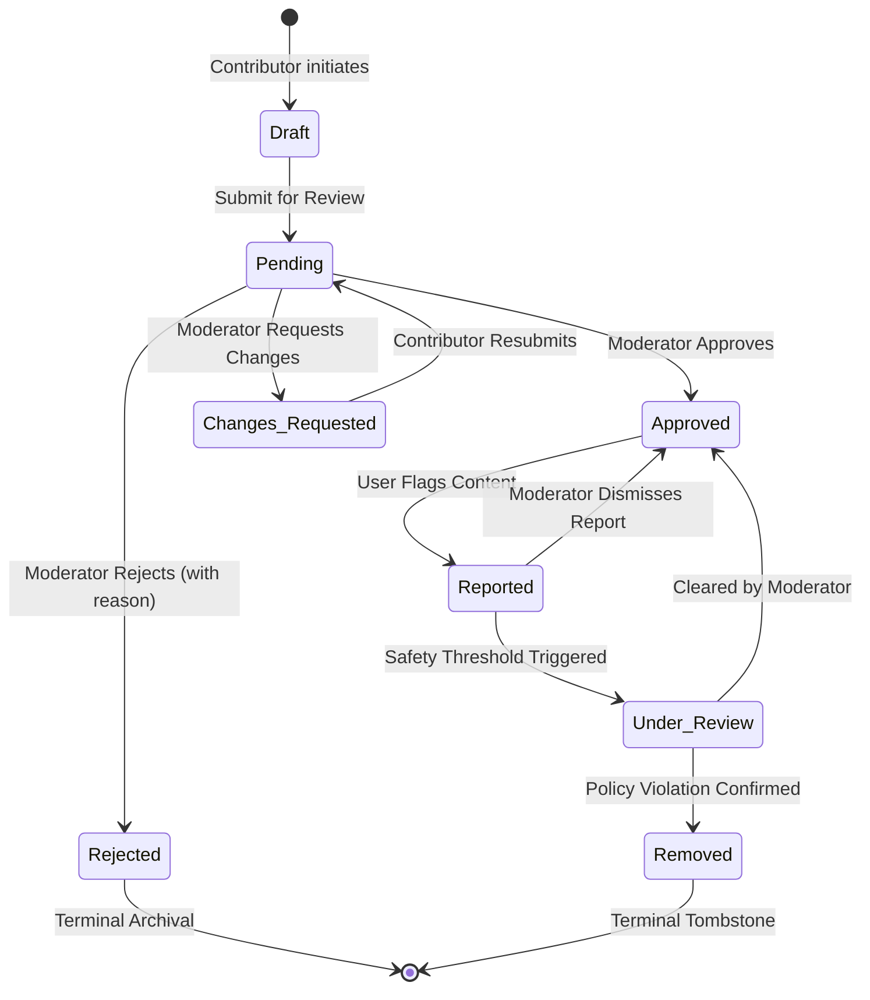
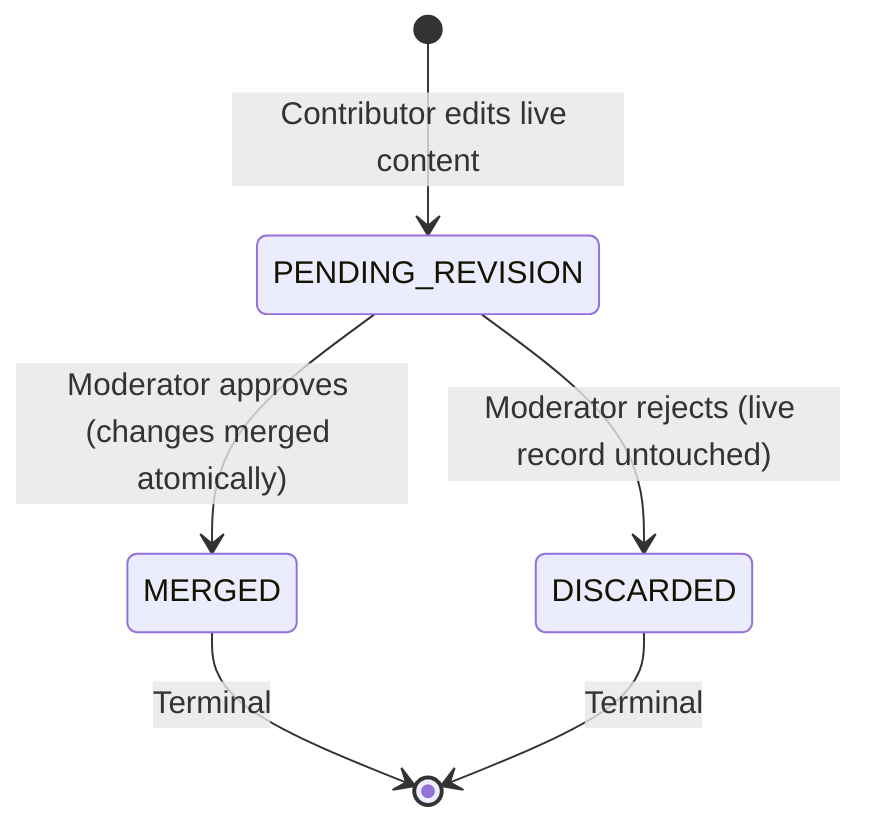

# Ubiquitous Language — Campus Placement Intelligence Platform

## 1. Purpose & Authority

This document is the authoritative domain glossary for the **Campus Placement Intelligence Platform**. It establishes the unambiguous vocabulary shared across the product vision, requirements, domain models, database schemas, API contracts, user interfaces, automated tests, and academic documentation for **IT643 — Software Design and Testing**.

The platform is a student-driven, university-specific placement intelligence and preparation platform. The initial launch institution is **Dhirubhai Ambani University (DAU)**, while the underlying architecture and data models support multi-university extensibility.

*For physical repository structure, cloud database infrastructure (Neon PostgreSQL 18.6), and dual-endpoint routing, refer to [README.md](file:///c:/Users/amanr/OneDrive/Documents/Projects/CampusPrep/README.md) and [PROJECT_CONTEXT.md Section 8](file:///c:/Users/amanr/OneDrive/Documents/Projects/CampusPrep/documents/PROJECT_CONTEXT.md#8-technical-architecture--data-models).*

### Naming Discipline & Framework Distinction
Domain concepts and business logic abstractions must use precise ubiquitous terminology rather than generic catch-all words (e.g., do not name business domain services `PlacementManager`, `DriveHandler`, or `DataUtil`; use concrete domain entities like `DriveService` or `WorkspaceService`). However, standard framework-level technical primitives (such as Django's built-in `models.Manager`, DRF `BasePermission`, or HTTP middleware) are recognized infrastructure components and are permitted within their technical roles.

---

## 2. Terminology Table & Code Mapping

In accordance with the IT643 Ubiquitous Language specification, the table below maps each domain term to its precise definition, explicit aliases to avoid, and the exact architectural location where the concept is realized in code. Aliases to Avoid apply to code identifiers, UI labels, and API field names. They do not apply to ordinary English words inside definitions.

> [!IMPORTANT]
> **Architectural Specification & Verification Status:** The paths and modules listed in this document describe the intended architecture. Implementation status must be verified against the actual repository. Database persistence must not be claimed until a successful connection and schema verification have been performed.

| Domain Term | Official Definition | Aliases to Avoid (Prohibited) | Named in Code At |
| :--- | :--- | :--- | :--- |
| **University** | An educational institution whose students, alumni, and recruitment events are represented on the platform. | College, School, Org, Tenant. (Note: "Campus" is prohibited on its own; permitted only within "Campus Drive"). | `apps.universities.models.University` |
| **Company** | A persistent commercial organization or corporate employer that conducts recruitment. | Recruiter, Org, Business, Corporate, Firm | `apps.companies.models.Company` |
| **Campus Drive** | A discrete, point-in-time recruitment event conducted by a specific Company at a specific University for a given recruitment cycle. | Placement Drive, Hiring Event, Visit, Drive Event, Job Fair | `apps.drives.models.CampusDrive` |
| **Recruitment Cycle** | The placement-season end year in which a Campus Drive occurs (e.g., July 2025 to June 2026 = Cycle `2026`). Integer year, value object. Independent of the student's graduating class (pre-final-year internship drives fall in the same cycle). | Batch Year, Graduating Batch Year, Batch, Placement Season, Drive Year, Hiring Season | `apps.drives.models.CampusDrive.recruitment_year` |
| **Job Role** | A specific employment position offered by a Company during a Campus Drive. | Job, Position, Vacancy, Opening, Designation | `apps.drives.models.JobRole` |
| **Eligibility Criteria** | The academic, disciplinary, and cohort prerequisites a candidate must satisfy to participate in a Campus Drive. | Requirements, Cutoffs, Qualifications, Rules | `apps.drives.models.CampusDrive.eligibility_summary` |
| **Selection Process** | The overall, ordered progression of stages designed by a Company to evaluate candidates during a Campus Drive. | Hiring Pipeline, Workflow, Recruitment Flow, Steps | `apps.drives.services.DriveService.get_selection_process` |
| **Selection Round** | An individual stage within a Selection Process (e.g., Online Assessment, Technical Interview, HR Interview). | Round (as standalone noun for entity), Interview, Stage, Step. (Note: Compound terms like Round Number, Round Type, and Round Interview Detail are permitted). | `apps.drives.models.SelectionRound` |
| **Round Number** | The 1-based, contiguous sequential position of a Selection Round within a Selection Process (Round 1, 2, ...). | Sequence, Order, Step Index, Stage Number | `apps.drives.models.SelectionRound.round_number` |
| **Round Type** | The structural category of a Selection Round: `ONLINE_ASSESSMENT`, `CODING_TEST`, `GROUP_DISCUSSION`, `TECHNICAL_INTERVIEW`, `HR_INTERVIEW`, or `HYBRID`. | Category, Kind, Assessment Type | `apps.common.enums.RoundType` |
| **Difficulty** | The qualitative assessment rating of a Selection Round: `EASY`, `MEDIUM`, or `HARD`. | Level, Hardness | `apps.drives.models.SelectionRound.difficulty` |
| **Interview Experience** | A structured, first-hand account submitted by a candidate detailing their participation in a specific Campus Drive. | Review, Interview Review, Experience Post, Feedback | `apps.experiences.models.InterviewExperience` |
| **Round Interview Detail** | The breakdown within an Interview Experience detailing questions asked, topics assessed, and candidate approach for a specific Selection Round. | Round Feedback, Question Log, Round Experience | `apps.experiences.models.RoundInterviewDetail` |
| **Candidate Outcome** | The final recruitment result achieved by a candidate in an Interview Experience: `OFFERED`, `REJECTED`, or `WITHDREW`. | Offer Status, Result, Verdict. (Note: Standalone "status" is strictly reserved for Publication Status). | `apps.common.enums.CandidateOutcome` |
| **Company Review** | An evaluative workplace assessment submitted by an Alumni Contributor with declared, moderator-reviewed Employment Experience at the Company. | Feedback, Rating, Post, Glassdoor Post, Testimonial | `apps.reviews.models.CompanyReview` |
| **Employment Experience** | A contributor's declared employer, title, and dates stored in an approved Alumni Qualification Declaration. Stated employee context (`CURRENT_EMPLOYEE` or `FORMER_EMPLOYEE`) is captured on the review. | Job History, Work Record, Resume Entry | `apps.users.models.AlumniQualificationDeclaration`, `apps.reviews.models.CompanyReview.employment_status` |
| **Compensation Information** | Disclosed financial remuneration details (`base_salary`, `total_ctc`, currency) tied to a specific Job Role within a Campus Drive. | Package, Perks, Bounty, Pay Packet | `apps.drives.models.JobRole.total_ctc` |
| **Preparation Resource** | A curated reference, coding sheet, syllabus, external link, or practice guide intended to assist in placement preparation. | Material, Study Material, Link, Guide, Prep Doc | `apps.resources.models.PreparationResource` |
| **Preparation Task** | A private, actionable preparation item created by a Registered User in their personal workspace. | Todo, Checklist Item, Goal, Reminder, Prep Item | `apps.workspace.models.PreparationTask` |
| **Bookmark** | A private saved reference created by a Registered User linking to a Company, Campus Drive, or Preparation Resource. | Favorite, Saved Item, Star, Pin | `apps.workspace.models.Bookmark` |
| **Personal Workspace** | The private user area containing saved Bookmarks, Preparation Tasks, and personal readiness tracking. | Dashboard, Profile Page, User Home, Portal | `apps.workspace.services.WorkspaceService` |
| **Public Visitor** | An unauthenticated guest browsing published platform intelligence without submitting data. | Guest, Anonymous User, Visitor, Reader | `apps.users.permissions.IsPublicVisitor` |
| **Registered User** | An authenticated user possessing account credentials, capable of maintaining a Personal Workspace. | Basic User, Member, Account Holder | `apps.users.models.User` |
| **Contributor** | Generic lowercase usage for any authenticated user who authors content. Not a distinct security role. | Poster, Writer | `apps.common.mixins.ContributedContentMixin.author` |
| **Verified Contributor** | A Registered User whose institutional affiliation has been confirmed through Institutional Email Verification. | DAU User, Verified Student, College Member. (Note: Student roll number appears only inside Private Account Identity). | `apps.users.permissions.IsVerifiedContributor` |
| **Alumni Contributor** | A Verified Contributor who has an approved Alumni Qualification Declaration, qualified to submit Company Reviews. | Alum, Graduate, Ex-Student, Working Senior | `apps.users.permissions.IsAlumniContributor` |
| **Alumni Qualification Declaration**| A formal user-submitted declaration of graduation year, degree program, and employment history. When approved, derives `users.is_alumni_qualified = True`. Reviewing this declaration is a Moderation Action. | Alumni Form, Grad Verification, Work Attestation | `apps.users.models.AlumniQualificationDeclaration` |
| **Moderator** | A privileged user authorized to review pending submissions, request revisions, and resolve Content Reports. | Reviewer, Superuser, Platform Admin, Approver | `apps.users.permissions.IsModerator` |
| **Administrator** | A platform manager responsible for institution settings, global company seed data, and role assignments. | Root, Master Admin, SysAdmin | `apps.users.permissions.IsAdministrator` |
| **Institutional Email Verification**| The cryptographic challenge confirming control of an official institutional email address (`@dau.ac.in`), recorded in `users.institutional_email`. | Student Verification, Email Confirmation, Auth Check | `apps.users.services.VerificationService` |
| **Verification Challenge** | The cryptographic OTP challenge (6 digits, 15-minute expiry) dispatched during Institutional Email Verification. | Code, Token, PIN | `apps.users.models.VerificationChallenge` |
| **Contributor-Submitted Claim** | Information supplied by a user based on personal knowledge, subject to community moderation but not represented as external corporate HR fact. | User Truth, Verified Fact, Official Statement | `apps.common.mixins.ContributedContentMixin` |
| **Stable Pseudonym** | A persistent, non-identifying public display handle deterministically allocated at registration, but never publicly shown until the user becomes a Verified Contributor and publishes. | Username, Anon ID, Fake Name, Masked ID, Handle | `apps.users.models.User.stable_pseudonym` |
| **Private Account Identity** | Confidentially stored personal identity attributes (`institutional_email`, real name, student roll number, auth credentials, and Alumni Qualification Declaration fields: graduation year, degree program, employer name, job title, employment dates). | User PII, User Profile, Real Identity, Secret Info | `apps.users.models.User` |
| **Public Display Identity** | Stable Pseudonym + Affiliation Label + Recruitment Cycle year. | Profile Name, Author Handle, Public User | `apps.users.serializers.PublicAuthorSerializer` |
| **Affiliation Label** | The non-identifying textual badge in Public Display Identity indicating institutional standing (`Institution-verified email` or `DAU Alumni (declared)`). | Badge Text, Tag | `apps.users.serializers.PublicAuthorSerializer.affiliation_label` |
| **Publication Status** | The lifecycle visibility state of a moderatable record: `DRAFT`, `PENDING`, `CHANGES_REQUESTED`, `APPROVED`, `REPORTED`, `UNDER_REVIEW`, `REJECTED`, `REMOVED`. Publicly visible states are `{APPROVED, REPORTED}` (`PUBLIC_VISIBLE_STATUSES`). | State, Moderation State, Visibility, Stage | `apps.common.enums.PublicationStatus`, `apps.common.enums.PUBLIC_VISIBLE_STATUSES` |
| **Pre-publication Moderation** | A publication policy where submissions must be approved by an authorized Moderator before public indexing. | Prior Review, Gatekeeping, Pre-approval | `apps.moderation.services.ModerationService.review_submission` |
| **Post-publication Moderation** | A publication policy where low-risk content publishes immediately following automated validation, subject to subsequent reporting. | Reactive Moderation, Community Patrol | `apps.moderation.services.ModerationService.triage_report` |
| **Moderation Queue** | The ordered set of submitted records in `PENDING`, revisions in `PENDING_REVISION`, and records in `REPORTED` or `UNDER_REVIEW` awaiting triage. | Inbox, Review List | `apps.moderation.services.ModerationService.get_queue` |
| **Content Report** | A user-submitted flag reporting problematic, inaccurate, NDA-violating, or abusive content for moderator intervention. | Flag, Abuse Report, Complaint, Issue Ticket | `apps.moderation.models.ContentReport` |
| **Moderation Action** | An auditable administrative or moderator intervention changing a submission's Publication Status or approving an Alumni Qualification Declaration. | Review Decision, Status Change, Mod Log | `apps.moderation.models.ModerationAction` |
| **Content Revision** | A draft modification applied to an already-published record, requiring re-moderation before replacing the live record. | Edit, Update, Version, Change Request | `apps.moderation.models.ContentRevision` |
| **Revision Status** | The lifecycle state of a Content Revision: `PENDING_REVISION`, `MERGED`, `DISCARDED`. The live record remains in `APPROVED` throughout revision review. | Edit State, Version Status | `apps.common.enums.RevisionStatus` |
| **Declaration Status** | Compound term for the review state of an Alumni Qualification Declaration: `PENDING`, `APPROVED`, `REJECTED`, `CHANGES_REQUESTED`. Bare "status" is reserved for Publication Status. | Verification Status, Form State, status | `apps.users.models.AlumniQualificationDeclaration.declaration_status` |
| **Proposal Status** | Compound term for the review state of a proposed company: `PENDING`, `APPROVED`, `REJECTED`. Bare "status" is reserved for Publication Status. | Company Request State, status | `apps.companies.models.CompanyProposal.proposal_status` |
| **Report Status** | Compound term for the lifecycle triage state of a Content Report: `PENDING`, `REPORT_DISMISSED`, `ACTION_TAKEN`. Bare "status" is reserved for Publication Status. | Ticket State, Flag Status, status | `apps.moderation.models.ContentReport.report_status` |
| **Report Severity** | The risk assessment tier assigned to a Content Report: `LOW`, `MEDIUM`, `HIGH`, or `URGENT`. `URGENT` triggers immediate quarantine (`UNDER_REVIEW`). | Risk Tier, Priority | `apps.common.enums.ReportSeverity` |
| **Company Proposal** | A contributor submission proposing a company record not yet present in the admin-seeded company directory. "Propose New Company" refers strictly to the user-facing workflow name. | Add Company, Request Company, New Recruiter | `apps.companies.models.CompanyProposal` |
| **Candidate** | An authenticated student or alumni applicant participating in a Campus Drive or detailing their interview experience. | Applicant, Student, Test Taker | `apps.experiences.models.InterviewExperience.author` |
| **Company Profile** | The curated corporate overview, industry categorization, and aggregated placement statistics for a Company. | Company Page, Recruiter Info | `apps.companies.models.Company` |
| **Tenure Band** | Non-identifying aggregated employment duration range (`< 1 year`, `1-2 years`, `3-5 years`, `5+ years`) stored and displayed on Company Reviews to mitigate peer deanonymization. | Work Duration, Service Range, Exact Dates | `apps.reviews.models.CompanyReview.tenure_band` |
| **Job Role Family** | A standardized functional category enum (`SOFTWARE_ENGINEER`, `DATA_ENGINEER`, `QA_ENGINEER`, `PRODUCT`, `DESIGN`, `DEVOPS_SRE`, `OTHER`) stored and displayed on Company Reviews to prevent single-employee re-identification at small firms. `AlumniQualificationDeclaration.job_title` remains strictly confidential within Private Account Identity. | Job Title, Position Title, Free-text Title, Role Title | `apps.reviews.models.CompanyReview.job_role_family` |
| **Anti-Self-Approval Invariant** | Architectural invariant guaranteeing that a Moderator or Administrator can never execute a Moderation Action on any record they own across all moderatable models. | Self Approval, Self Review, Self Triage | `apps.moderation.services.ModerationService.resolve_record_owner_id` |
| **Public Feed** | The filterable query stream serializing published platform intelligence strictly matching `PUBLIC_VISIBLE_STATUSES`. | Public Stream, Listing, Catalog | `apps.common.enums.PUBLIC_VISIBLE_STATUSES` |
| **Rating** | A quantitative 1-to-5 star evaluation score assessing overall workplace quality or sub-dimensions (WLB, culture, growth, compensation). | Score, Grade, Stars | `apps.reviews.models.CompanyReview.overall_rating` |
| **Moderation Audit History** | The immutable log of administrative status transitions, review notes, and moderator actions. | Mod Log, Admin Log, History | `apps.moderation.models.ModerationAction` |

---

## 3. Flagged Ambiguities (Where Words Clash)

In real campus placement conversations, students and developers frequently use overlapping words for distinct concepts, or use different words for the exact same entity. To ensure software design precision, this section documents all identified ambiguities and declares **which concept wins**.

### Ambiguity 1: "Company" vs. "Campus Drive" vs. "Recruitment Cycle"
* **The Conflict:** Students often say: *"Google came to campus last week"*, *"Google in 2024 was harder than Google in 2025"*, or confuse whether "2025" means the calendar year the interview occurred or the graduating cohort year.
* **The Ambiguity:** Conflating the global corporate organization with a specific recruitment event, and confusing split calendar years with placement seasons.
* **Which One Wins:**
  * **`Company`** is strictly the global corporate employer (e.g., Google, Amazon, Sprinklr). It has an industry, headquarters, and global careers portal.
  * **`Campus Drive`** is strictly the time-bound event associated with a `(University, Company, Recruitment Cycle)`. Eligibility criteria belong to the `Campus Drive`, and compensation information (`total_ctc`, `base_salary`) belongs to the specific `Job Role` offered within that drive—never directly to the `Company`.
  * **`Recruitment Cycle`** (`recruitment_year`) is defined strictly as the **placement-season end year** (e.g., July 2025 to June 2026 = Cycle `2026`). It is an integer year value object and is strictly independent of the student's graduating class (pre-final-year internship drives fall in the same cycle).

### Ambiguity 2: "Company Review" vs. "Interview Experience"
* **The Conflict:** Contributors often use the generic word *"Review"* to describe both their job experience and their placement interview.
* **The Ambiguity:** Blurring candidate evaluation accounts with employee workplace assessments.
* **Which One Wins:**
  * **`Interview Experience`** is an applicant's first-hand account of participating in a specific `Campus Drive`'s selection rounds. It discusses coding questions, technical round topics, and candidate preparation strategies.
  * **`Company Review`** is an employee's professional assessment of an organization's work-life balance, culture, internal management, and long-term career growth. It requires a declared, moderator-reviewed `Employment Experience` and is restricted to alumni with professional experience.

### Ambiguity 3: "Verification" (Affiliation vs. Employment vs. Interview Claims)
* **The Conflict:** A user profile says "Verified", leading readers to assume their interview questions or salary claims are verified facts.
* **The Ambiguity:** Overloading institutional email confirmation to mean verified truth of submitted content.
* **Which One Wins:**
  * **`Institutional Email Verification`** confirms ONLY that the user controls an active institutional email address (e.g., `@dau.ac.in`).
  * Claims regarding interview participation, questions encountered, and compensation are **Contributor-Submitted Claims**. They are subject to moderation for quality, but the platform does NOT claim external HR verification.

### Ambiguity 4: "Selection Process" vs. "Selection Round"
* **The Conflict:** People say *"The round was four stages long"* or *"The interview had two tests."*
* **The Ambiguity:** Using "round" and "process" interchangeably.
* **Which One Wins:**
  * **`Selection Process`** is the aggregate ordered collection of all evaluation steps for a Campus Drive.
  * **`Selection Round`** is exactly ONE stage in that process (e.g., Round 1: OA, Round 2: Tech Interview 1). It has an invariant `round_number` sequence.

### Ambiguity 5: "Stable Pseudonym" vs. "Anonymous"
* **The Conflict:** Describing the platform as an "anonymous forum."
* **The Ambiguity:** Absolute anonymity implies no identity is stored and actions cannot be traced, while pseudonymous identity maintains contributor reputation and internal moderation accountability.
* **Which One Wins:**
  * The platform uses **`Stable Pseudonym`**. The public sees a consistent non-identifying handle (e.g., `CampusExplorer_42`). Internally, moderation and security logs retain a protected link to the `Private Account Identity` to handle legal or code-of-conduct violations. Absolute anonymity is never claimed.
  * **System Guarantee vs. Residual Re-identification Risk:**
    * *Core Guarantee:* The platform guarantees **pseudonymous accountability** (internal moderator auditability) and **strict PII isolation** (zero public serialization of real names, institutional emails, roll numbers, or auth hashes). It does *not* claim mathematical k-anonymity or absolute anonymity against peers with out-of-band social knowledge.
    * *Interview Experiences:* In small university cohorts (e.g., specialized cohorts with < 25 students), the combination of `(campus_drive, recruitment_year, candidate_outcome, affiliation_label)` acts as a quasi-identifier. While suppressing submission timestamps prevents temporal correlation attacks (e.g., matching the post time with an interview schedule), drive + outcome correlation remains an acknowledged residual risk.
    * *Company Reviews:* Presenting company, job title, and pseudonym together poses a re-identification risk, particularly at boutique firms or specialized divisions. To mitigate this risk, public displays should generalize niche job titles into broad job role families (e.g., "Software Engineer" rather than hyper-specific internal titles) and aggregate tenure into broad duration bands rather than disclosing exact calendar dates.

### Ambiguity 6: "Preparation Task" vs. "Preparation Resource"
* **The Conflict:** Users referring to *"My prep materials"* for both external study links and their personal study to-do list.
* **The Ambiguity:** Mixing shared knowledge assets with private user state.
* **Which One Wins:**
  * **`Preparation Resource`** is a public, shared educational reference (link, cheat sheet, question set) visible across the platform.
  * **`Preparation Task`** is a private, personal to-do item in a user's Personal Workspace with a due date and completion checkbox.

### Ambiguity 7: "Contributor" vs. "Verified Contributor"
* **The Conflict:** Developers and users referring to any logged-in user as a "contributor".
* **The Ambiguity:** Conflating the generic user action of authoring with the specific privileged role possessing verified institutional affiliation.
* **Which One Wins:**
  * **`Contributor`** is a generic descriptive noun for any authenticated user who authors content.
  * **`Verified Contributor`** is the formal security role earned via Institutional Email Verification, authorized to submit university-specific recruitment intelligence.

### Ambiguity 8: "Experience" & "Review" (Contextual Clashes)
* **The Conflict:** Using "experience" for work background and interview accounts; using "review" for company evaluation and moderation actions.
* **The Ambiguity:** Overloading core nouns across authoring and moderation.
* **Which One Wins:**
  * **`Interview Experience`** is strictly the candidate's account of a Campus Drive.
  * **`Employment Experience`** is strictly the declared, moderator-reviewed work history in an Alumni Qualification Declaration.
  * **`Company Review`** is strictly the workplace assessment submitted by an alumnus.
  * The moderator action is always called **`moderation`** or **`review_submission`** (`apps.moderation.services.ModerationService.review_submission`), never standalone "review".

### Ambiguity 9: "Role" (User Role vs. Job Role vs. Role Type)
* **The Conflict:** Developers saying *"Check the user's role"*, *"What is the job role?"*, and *"Filter by role type"*.
* **The Ambiguity:** Triplicate usage of the bare word "Role".
* **Which One Wins:**
  * User permissions are strictly called **"User Role"** (`Registered User`, `Verified Contributor`, `Alumni Contributor`, `Moderator`, `Administrator`).
  * The employment position offered by a company is strictly called **`Job Role`**.
  * The specific field `JobRole.role_type` (e.g., `FULL_TIME`, `INTERNSHIP`) is strictly called **"Job Role type"**.

### Ambiguity 10: "Verified" in Verified Contributor
* **The Conflict:** Readers or developers assuming a "Verified Contributor" post represents verified factual truth.
* **The Ambiguity:** Conflating identity/email verification with content accuracy verification.
* **Which One Wins:**
  * "Verified" in **`Verified Contributor`** strictly and exclusively certifies possession of an active university email (`@dau.ac.in`). It does not verify the truth, accuracy, or HR validation of any submitted claim.

---

## 4. Identity, Visibility & Invariants

> [!CAUTION]
> **Privacy Invariant:** Under zero circumstances may `Private Account Identity` attributes (`institutional_email`, real name, student roll number, auth credentials, or Alumni Qualification Declaration fields: graduation year, degree program, employer name, job title, and employment dates) be serialized or transmitted through public API endpoints.

> [!NOTE]
> **UI Rule for Affiliation Display:** The affiliation badge displayed in user interfaces must read `Institution-verified email` or `DAU Alumni (declared)`, never just `Verified`.

> [!TIP]
> **Public Detail Aggregation & Re-identification Bounds:**
> 1. *Recruitment Cycle Truncation:* Interview Experiences expose only the calendar year (`recruitment_year`), suppressing exact submission timestamps to eliminate temporal correlation attacks.
> 2. *Job Role Family & Tenure Band Standardization:* Public Company Reviews display standardized `Job Role Family` enums and coarse `Tenure Band` ranges rather than granular free-text job titles, internal team names, or calendar date ranges, eliminating deanonymization vectors for alumni at small companies. `AlumniQualificationDeclaration` free-text job titles remain strictly confidential within `Private Account Identity`.
> 3. *Pseudonymous Guarantee:* Absolute anonymity is neither claimed nor mathematically guaranteed against in-group background knowledge; the platform enforces robust pseudonymous privacy combined with internal auditability for abuse mitigation.

*Full identity, authentication, and privacy flows live in `PROJECT_CONTEXT.md` Sections 4 and 5.*

---

## 5. Content Moderation & Publication Lifecycle

Content published to the platform follows two distinct publication tracks based on content type:

### 5.1 Pre-Publication Moderation Track
Applies to high-risk, institutionally sensitive content: **Interview Experiences**, **Company Reviews**, and **Campus Drive** submissions.

### 5.2 Post-Publication Moderation Track
Applies to low-risk content: **Preparation Resources**.
* Upon submission, automated syntax and URL validation executes immediately.
* If validation succeeds, the record transitions directly to `APPROVED` and becomes publicly discoverable.
* If flagged by users via `Content Report`, it transitions to `REPORTED` and enters the Moderation Queue without disrupting active search unless escalated to `UNDER_REVIEW`.

### 5.3 Content Revision Lifecycle (Approved Decision 3)
When an author edits an already-published `Interview Experience` or `Company Review`, a `ContentRevision` is spawned while the live record remains `APPROVED`:

### Complete Publication Status Enum (8 States):
* **`DRAFT`**: The record is under composition by the author; hidden from moderators and the public.
* **`PENDING`**: The record has been submitted and awaits Moderator evaluation in the Moderation Queue; hidden from the public.
* **`CHANGES_REQUESTED`**: A Moderator has returned the record with actionable feedback; hidden from the public.
* **`APPROVED`**: The record satisfies quality guidelines and is discoverable in public feeds.
* **`REPORTED`**: An approved record has received a `Content Report`; remains publicly visible during triage unless safety thresholds move it to `UNDER_REVIEW`.
* **`UNDER_REVIEW`**: Content whose public visibility is temporarily suppressed while undergoing formal moderator investigation.
* **`REJECTED`**: The submission fails quality or policy standards; hidden from the public with rejection reason recorded.
* **`REMOVED`**: The record has been retracted due to confirmed policy, copyright, or privacy violations; permanently hidden from public feeds.

> [!IMPORTANT]
> **Public Visibility Invariant:** Public query feeds strictly serialize content whose Publication Status is in `PUBLIC_VISIBLE_STATUSES` (`APPROVED` or `REPORTED`). Records in any other state (`DRAFT`, `PENDING`, `CHANGES_REQUESTED`, `UNDER_REVIEW`, `REJECTED`, or `REMOVED`) are strictly excluded. `PUBLIC_VISIBLE_STATUSES` never applies to Alumni Qualification Declarations. Declarations are never publicly serialized, regardless of their status.

*Full moderation workflows live in `PROJECT_CONTEXT.md` Section 7.*

---

## 6. Core Access & Invariant Rules

1. **Public Browsing:** `Public Visitor` users can freely search, read, and filter published `Company` profiles, `Campus Drive` histories, `Interview Experience` logs, `Company Review` summaries, and `Preparation Resource` catalogs without authenticating.
2. **Workspace Access:** Only authenticated `Registered User` accounts can access the `Personal Workspace`, manage `Preparation Task` items, and toggle `Bookmark` references.
3. **Campus Intelligence Submission & Verification Barrier:** Only accounts possessing confirmed institutional affiliation (`is_verified_contributor = True`) can author `Interview Experience` entries and contribute `Campus Drive` intelligence. Administrative and moderator roles grant elevated review permissions, but never exempt an author from institutional verification when submitting campus intelligence.
4. **Company Review Submission:** Only `Alumni Contributor` accounts possessing verified institutional affiliation and an approved `Alumni Qualification Declaration` (declared, moderator-reviewed `Employment Experience`) can submit a `Company Review`.
5. **No Cross-Overwriting Invariant:** Submitting intelligence for a 2026 Campus Drive must never overwrite or delete the records of the 2025 or 2024 Campus Drives for that company.
6. **No Phantom Author Disclosures:** The platform author signature must always reflect the author's `Stable Pseudonym`. No option exists to post under an arbitrary unverified alias.
7. **Anti-Self-Approval Invariant:** Under zero circumstances may a `Moderator` or `Administrator` review, approve, reject, merge, or triage reports on any record that they own across all models (`author_id`, `user_id`, or `proposer_id`). Any self-owned submission (Interview Experience, Company Review, Content Revision, Company Proposal, or Alumni Qualification Declaration) must be evaluated by an independent moderator.
8. **Drive Experience Uniqueness Invariant:** A contributor may submit at most one `Interview Experience` per `Campus Drive`. Any subsequent updates to that experience must proceed through the `Content Revision` workflow.

*Full permissions matrix lives in `PROJECT_CONTEXT.md` Section 3.*

---

## 7. Maintenance & Enforcement

This document is living, but strictly protected. Any alteration to a domain term or state transition requires:
1. Prior review of all dependent models, serializers, services, tests, and documentation.
2. Synchronized updates to `PROJECT_CONTEXT.md` and `DESIGN.md`.
3. Maintenance of the mapping table in Section 2, ensuring every code reference points to real code.

### 7.1 Automated Verification Matrix
To ensure code never diverges from the authoritative specifications in `PROJECT_CONTEXT.md` and this Ubiquitous Language specification, the following automated test suites enforce every canonical business rule:

| Rule # | Canonical Business Rule / Invariant | Automated Test File | Passing Assertion / Target Service |
| :--- | :--- | :--- | :--- |
| **Rule 1** | **Institutional Verification Barrier** (unverified users blocked from submitting campus intelligence) | `backend/tests/test_business_rule_1_verification_barrier.py` | `IsVerifiedContributor`, `VerificationService.validate_otp` |
| **Rule 2** | **Selection Round Sequence Continuity** (strictly contiguous 1..N sequence, gap detection) | `backend/tests/test_business_rule_2_selection_rounds.py` | `SequenceGapException`, `DuplicateRoundNumberException` |
| **Rule 3** | **Moderation Visibility Guard** (only `APPROVED` and `REPORTED` serialized in public feeds) | `backend/tests/test_business_rule_3_moderation_visibility.py` | `PUBLIC_VISIBLE_STATUSES`, `ModerationService.review_submission` |
| **Rule 4** | **Identity Whitelist Isolation** (zero PII leakage, `stable_pseudonym` only) | `backend/tests/test_business_rule_4_identity_whitelist.py` | `PublicAuthorSerializer` strict whitelist isolation |
| **Rule 5** | **Personal Workspace User Isolation** (users can view/edit only their own tasks/bookmarks) | `backend/tests/test_business_rule_5_workspace_isolation.py` | `WorkspaceService` scoped query filtering & `PermissionDenied` |
| **AD-3** | **Content Revision Traceability** (`APPROVED` live record preservation during drafts) | `backend/tests/test_architectural_decision_3_content_revisions.py` | `RevisionStatus.PENDING_REVISION` & atomic `MERGED` transition |
| **Invariant** | **Anti-Self-Approval Invariant** (moderator cannot review own records across models) | `backend/tests/test_invariant_anti_self_approval.py` | `ModerationService.resolve_record_owner_id` & `PermissionDenied` |
| **Invariant** | **Cross-Drive Invariant** (selection round must belong to same drive as interview experience) | `backend/tests/test_invariant_round_detail_same_drive.py` | `RoundInterviewDetail.clean` `ValidationError` |

*For complete test execution commands and developer setup, refer to [README.md](file:///c:/Users/amanr/OneDrive/Documents/Projects/CampusPrep/README.md).*

